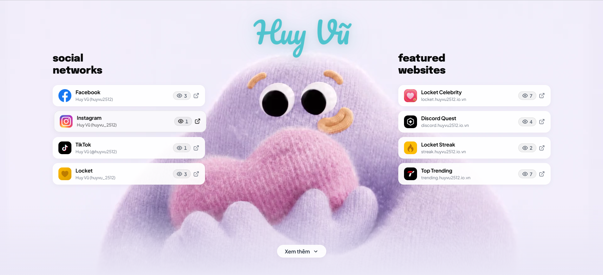

<div align="center">

# Huy Vũ (@huyvu2512)

**Bio cá nhân của Huy Vũ (@huyvu2512) — Tổng hợp liên kết các trang mạng xã hội và dự án cá nhân**

[](https://react.dev/)
[](https://www.typescriptlang.org/)
[](https://vitejs.dev/)
[](https://firebase.google.com/)
[](https://vercel.com/)
[](./LICENSE)

[](https://github.com/huyvu2512/huyvu2512.io.vn/stargazers)
[](https://github.com/huyvu2512/huyvu2512.io.vn/forks)
[](https://github.com/huyvu2512/huyvu2512.io.vn/issues)
[](https://github.com/huyvu2512/huyvu2512.io.vn/commits/main)


[Xem Website](https://huyvu2512.io.vn/) · [Báo Lỗi](https://github.com/huyvu2512/huyvu2512.io.vn/issues) · [Yêu Cầu Tính Năng](https://github.com/huyvu2512/huyvu2512.io.vn/issues)

</div>

---

<div align="center">
  
</div>

---

## Giới thiệu

Website cá nhân và trang liên kết hồ sơ của **Huy Vũ (@huyvu2512)**. Dự án được xây dựng với mục tiêu tối ưu hiệu năng tải trang, trải nghiệm tương tác trực quan và giao diện thích ứng linh hoạt trên mọi kích thước thiết bị.

Hệ thống kết hợp giữa giao diện người dùng thời gian thực và backend serverless để theo dõi lưu lượng truy cập mà không làm chậm tốc độ tải trang ban đầu.

---

## Tính năng chính

- **Mắt nhân vật tương tác trực quan:** Tính toán góc vector thời gian thực từ vị trí con trỏ chuột hoặc cử chỉ chạm, kết hợp thuật toán làm mượt chuyển động (linear interpolation) và tua frame video qua `fastSeek`.
- **Bố cục hai tầng cân xứng hoàn hảo (4 - 4 Layout):**
  - **Trang 1:** 4 mạng xã hội chính bên trái đối xứng với 4 dự án website tiêu biểu bên phải (*Locket Celebrity, Discord Quest, Locket Streak, Top Trending*).
  - **Trang 2 (Showcase):** Tổng hợp toàn bộ mạng xã hội dạng link pills (Beacons style) và các dự án cá nhân (*Cookie Checker, YouTube Customizer, Colab Drive...*) dạng visual cards với banner lớn.
- **Tự động đồng bộ tài sản trực tuyến (Live Online Assets):** Nạp icon và banner preview trực tiếp từ domain/repo của từng dự án con, tự động cập nhật khi dự án con thay đổi mà không cần lưu trữ tĩnh trong repo.
- **Hệ thống theo dõi lượt truy cập Serverless:**
  - Giao tiếp trực tiếp với Google Firestore qua REST API v1, không phụ thuộc vào Firebase Client SDK nhằm giảm kích thước bundle.
  - Tự động nhận diện thiết bị và IP tại tầng server để chống spam lượt xem theo ngày (mỗi thiết bị chỉ tính 1 lượt xem cho mỗi liên kết trong 24 giờ).
  - Tự động quét và dọn dẹp các bản ghi log cũ khi bước sang ngày mới nhằm tiết kiệm tài nguyên lưu trữ.
- **Tối ưu hiển thị đa thiết bị:**
  - **Desktop:** Khung video toàn cảnh với hiệu ứng chuyển màu mềm mại.
  - **Tablet & iPad:** Tự động điều chỉnh khoảng cách lề, kích thước badge và áp dụng cắt gọn chuỗi (ellipsis) chống vỡ khung.
  - **Mobile:** Video mở rộng sát viền màn hình, bố cục phân cấp liền mạch và cho phép cuộn trang tự nhiên.
- **Tiêu chuẩn SEO & Web Standards:** Đầy đủ metadata Open Graph chuẩn 1200x630, Twitter Cards, Sitemap XML, Robots.txt và Web App Manifest.

---

## Công nghệ sử dụng

| Thành phần | Công nghệ | Mục đích |
| :--- | :--- | :--- |
| **Frontend** | React 19, TypeScript 5, Vite 8 | Xây dựng giao diện đơn trang với hiệu năng cao |
| **Styling** | CSS3 Thuần | Kiểm soát bố cục chính xác, không phát sinh runtime overhead |
| **Backend API** | Vercel Serverless Functions | Xử lý logic đếm lượt xem và xác thực IP độc lập |
| **Cơ sở dữ liệu** | Google Cloud Firestore | Lưu trữ thống kê số lượt xem qua REST API |
| **Hạ tầng** | Vercel | Phân phối nội dung tĩnh trên mạng lưới Edge Network |

---

## Cấu trúc thư mục

```text
huyvu2512/
├── api/
│   ├── verify.ts         # Serverless function xác thực thiết bị và cấp token bảo mật
│   └── views.ts          # Serverless function xử lý ghi nhận và đồng bộ lượt xem
├── public/
│   ├── assets/           # Tài nguyên tĩnh nội bộ (ảnh, video, logo và banner xem trước)
│   │   ├── footer-poster.webp # Ảnh đại diện khung hình video nhân vật
│   │   ├── footer-scrub.mp4   # Video tương tác của nhân vật
│   │   ├── header-logo.webp   # Logo nhận diện thương hiệu Huy Vũ
│   │   ├── logo.png           # Biểu tượng ứng dụng và favicon
│   │   ├── preview.jpg        # Phiên bản JPG siêu nhẹ phục vụ Messenger / Facebook Scraper
│   │   └── preview.png        # Hình ảnh xem trước khi chia sẻ liên kết (Open Graph Banner 1200x630)
│   ├── fonts/            # Bộ font chữ phục vụ hiển thị ngoại tuyến
│   ├── icons/            # Biểu tượng các mạng xã hội cố định
│   ├── robots.txt        # Tệp chỉ thị cho công cụ tìm kiếm
│   ├── sitemap.xml       # Sơ đồ trang web chuẩn XML
│   └── site.webmanifest  # Cấu hình cài đặt Web App (PWA)
├── src/
│   ├── App.tsx           # Component gốc của ứng dụng
│   ├── BrandLogo.tsx     # Chữ ký nhận diện thương hiệu
│   ├── FooterBackground.tsx # Logic điều khiển khung video theo tọa độ mắt
│   ├── gaze-frames.json  # Bộ dữ liệu map góc nhìn và mốc thời gian video
│   ├── icons.tsx         # Hệ thống biểu tượng SVG tối ưu
│   ├── index.css         # Hệ thống biến thiết kế và media queries
│   ├── main.tsx          # Khởi tạo React DOM
│   ├── socialData.ts     # Dữ liệu cấu hình các liên kết và dự án
│   └── viewTracker.ts    # Module gửi request theo dõi lượt xem từ client
├── vercel.json           # Cấu hình định tuyến, cache và tiêu đề bảo mật
└── vite.config.ts        # Thiết lập Vite và middleware giả lập API local
```

---

## Giấy phép

Dự án được phát hành theo giấy phép [MIT License](./LICENSE). Bản quyền thuộc về **Huy Vũ (@huyvu2512)**.
